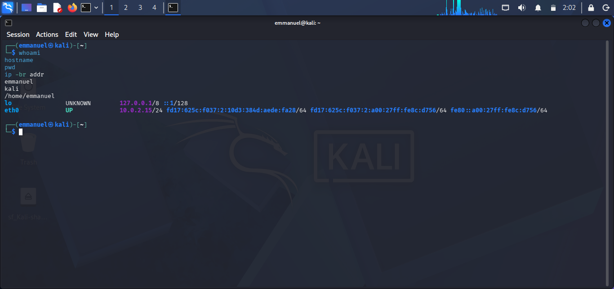
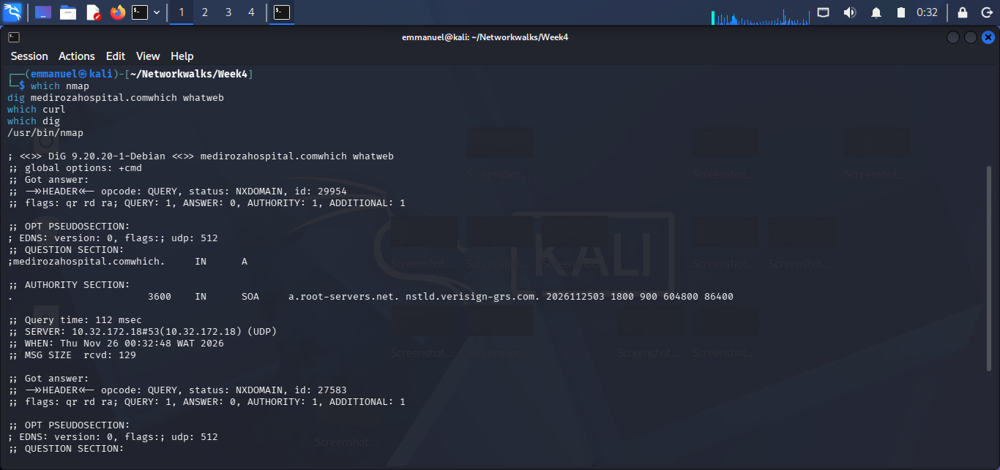
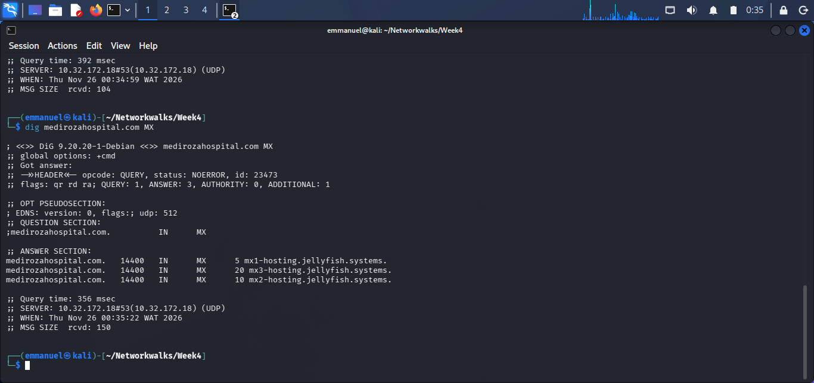
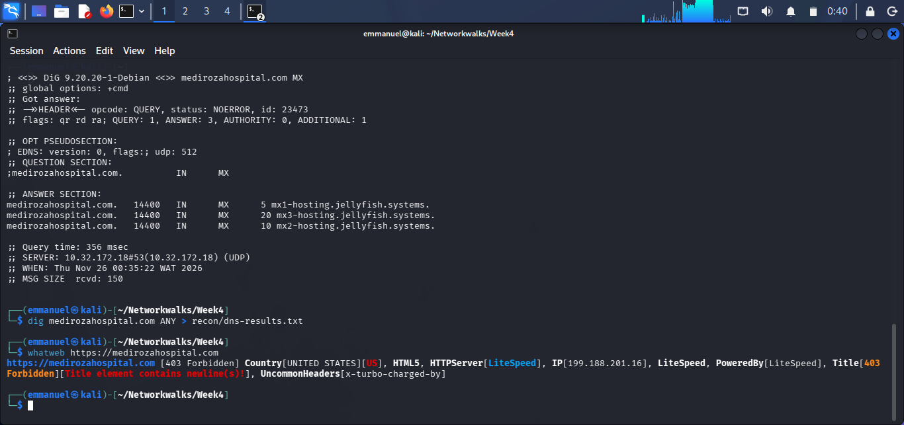
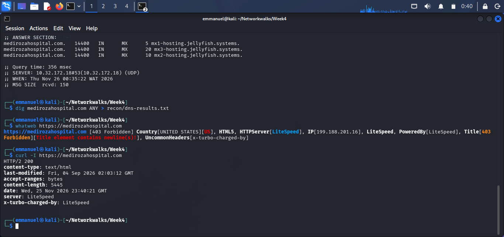
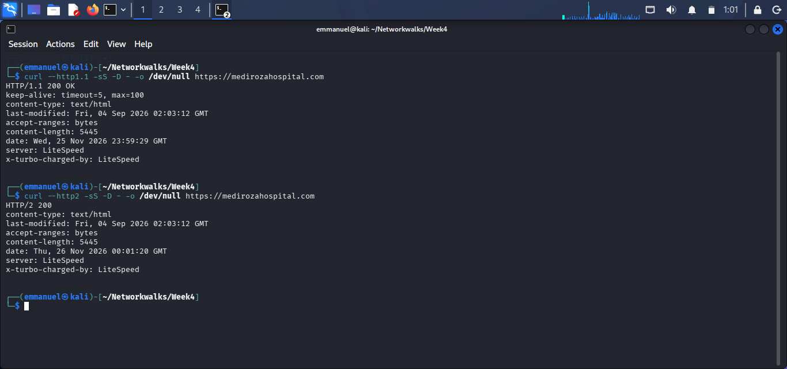
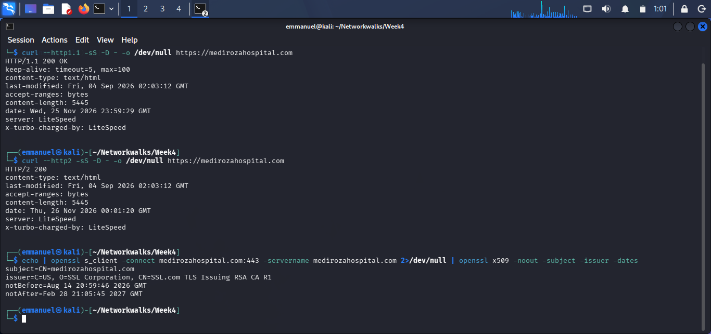
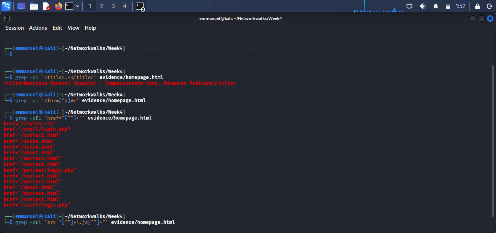

# NETWORKWALKS WEEK 4
# RECONNAISSANCE AND INFORMATION GATHERING REPORT

---

## 1. Assessment Overview

| Assessment Information | Details |
|---|---|
| Programme | Networkwalks Cybersecurity Internship |
| Batch | B083 |
| Project | Week 4 — Black-Box Penetration Testing |
| Target Organisation | Mediroza General Hospital |
| Target Domain | `medirozahospital.com` |
| Target URL | `https://medirozahospital.com` |
| Assessment Type | Black-Box Security Assessment |
| Assessment Phase | Initial Reconnaissance |
| Operating System | Kali Linux |
| Primary Tester | Oluwaferanmi Idowu |
| Report Status | Initial Reconnaissance Completed |

## 2. Executive Summary

This report documents the initial reconnaissance and information-gathering activities conducted as part of the Networkwalks Week 4 penetration-testing assignment.

The primary objective was to establish an initial understanding of the target's publicly observable infrastructure, DNS configuration, web technologies, HTTP behaviour, TLS certificate information, and homepage structure.

The assessment employed several standard reconnaissance utilities available in Kali Linux, including `dig`, `WhatWeb`, `curl`, `OpenSSL`, `grep`, and `file`.

The activities identified the target's IPv4 address, authoritative name servers, mail exchange records, web server technology, supported HTTP protocols, TLS certificate details, and publicly referenced website paths.

The reconnaissance phase established a baseline for subsequent vulnerability assessment activities.

No confirmed security vulnerability was established solely through the activities documented in this report.

## 3. Assessment Objectives

The objectives of the reconnaissance phase were to:

1. Identify publicly available DNS information associated with the target domain.
2. Determine the target's IPv4 and IPv6 DNS resolution status.
3. Identify publicly observable web server technologies.
4. Inspect HTTP response headers and server behaviour.
5. Verify HTTP/1.1 and HTTP/2 responses.
6. Examine the target's TLS certificate information.
7. Inspect the homepage's HTML structure.
8. Identify publicly referenced website resources and authentication entry points.
9. Document observations and supporting evidence for subsequent assessment phases.

## 4. Scope and Authorisation

The assessment was conducted under the scope provided for the Networkwalks Week 4 assignment.

**Target:**
`https://medirozahospital.com`

The reconnaissance activities documented here were limited to information gathering and inspection of publicly accessible resources.

The assessment did not include:

- Denial-of-service testing.
- Social engineering.
- Unauthorised access to restricted systems.
- Retrieval or publication of real patient records.
- Disclosure of employee credentials or confidential personal information.
- Testing outside the stated assessment scope.

Any subsequent testing involving authentication, access controls, or sensitive information must use explicitly approved test accounts and synthetic data.

## 5. Testing Environment and Tools

### 5.1 Operating Environment

The assessment was conducted using Kali Linux.

The following commands were used to inspect the testing environment:

```bash
whoami
hostname
pwd
ip -br addr
```

### 5.2 Tools Used

| Tool | Function |
|---|---|
| Kali Linux | Security testing environment |
| dig | DNS enumeration and record inspection |
| WhatWeb | Web server and technology fingerprinting |
| curl | HTTP response and header inspection |
| OpenSSL | TLS certificate inspection |
| grep | HTML content and resource extraction |
| file | File-type identification |

### 5.3 Environment Evidence

**Evidence E01 — Kali Linux Testing Environment**



[Open E01 — Kali Linux Environment](screenshots/01-kali-environment.png)

## 6. DNS Enumeration

DNS enumeration was performed using `dig` to identify publicly available DNS records associated with the target domain.

### 6.1 IPv4 Address Enumeration

**Command:**

```bash
dig medirozahospital.com A
```

**Results:**

| Attribute | Observation |
|---|---|
| Query Type | A |
| DNS Status | NOERROR |
| IPv4 Address | `199.188.201.16` |

The DNS query successfully resolved the target domain to the IPv4 address `199.188.201.16`.

This address represents the IPv4 endpoint returned by DNS during the assessment.

**Evidence E02 — DNS A Record**



[Open E02 — DNS A Record](screenshots/02-dns-a-record.png)

### 6.2 Name Server Enumeration

**Command:**

```bash
dig medirozahospital.com NS
```

**Identified Name Servers:**

| No. | Name Server |
|---|---|
| 1 | `dns1.namecheaphosting.com` |
| 2 | `dns2.namecheaphosting.com` |

The results identified two name servers associated with the target domain.

These records provide information about the domain's DNS infrastructure.

### 6.3 Mail Exchange Enumeration

**Command:**

```bash
dig medirozahospital.com MX
```

**Identified Mail Exchange Records:**

| Priority | Mail Server |
|---:|---|
| 5 | `mx1-hosting.jellyfish.systems` |
| 10 | `mx2-hosting.jellyfish.systems` |
| 20 | `mx3-hosting.jellyfish.systems` |

The MX records identify the mail servers configured to receive email for the target domain.

### 6.4 IPv6 Enumeration

**Command:**

```bash
dig medirozahospital.com AAAA
```

**Observation:**

The query returned `NOERROR` but did not return any AAAA records.

This indicates that no IPv6 address was returned for the queried domain during the assessment.

It does not establish whether IPv6 is unavailable elsewhere in the target's infrastructure.

**Evidence E03 — DNS Name Server and Mail Exchange Records**



[Open E03 — DNS NS and MX Records](screenshots/03-dns-ns-mx-records.png)

## 7. Web Server Fingerprinting

Web technology fingerprinting was conducted using WhatWeb to identify technologies and server information exposed by the target.

**Command:**

```bash
whatweb -v https://medirozahospital.com
```

### 7.1 Observed Results

| Attribute | Result |
|---|---|
| Target Domain | `medirozahospital.com` |
| Resolved IP | `199.188.201.16` |
| Web Server | LiteSpeed |
| Identified Technology | HTML5 |
| Initial HTTP Response | 403 Forbidden |
| Additional Header | `x-turbo-charged-by` |

### 7.2 Analysis

WhatWeb identified LiteSpeed as the web server technology.

The initial WhatWeb request returned an HTTP `403 Forbidden` response.

However, subsequent requests using curl returned successful HTTP responses.

This difference indicates that the server's response varied between requests or request conditions. The observation was recorded for further investigation.

The response inconsistency was not classified as a vulnerability because the available evidence does not establish its underlying cause.

**Evidence E04 — WhatWeb Fingerprinting**



[Open E04 — WhatWeb Fingerprinting](screenshots/04-whatweb-fingerprinting.png)

## 8. HTTP Response and Header Analysis

HTTP response headers were inspected using curl to identify server information and other response metadata.

**Command:**

```bash
curl -I https://medirozahospital.com
```

### 8.1 Observed Response Information

| Header / Attribute | Observed Value |
|---|---|
| HTTP Status | `200 OK` |
| Content-Type | `text/html` |
| Server | LiteSpeed |
| Content-Length | `5445` bytes |
| Additional Header | `x-turbo-charged-by: LiteSpeed` |

### 8.2 Analysis

The response indicated that the target returned an HTTP `200 OK` status for this request.

The server identified itself as LiteSpeed and returned an HTML document.

The response headers were recorded as part of the initial server configuration and information-disclosure review.

The presence or absence of individual headers should not independently be treated as proof of a vulnerability. A broader security-header assessment would be required.

**Evidence E05 — HTTP Response Headers**



[Open E05 — HTTP Response Headers](screenshots/05-http-headers.png)

## 9. HTTP Protocol Verification

The target was tested using HTTP/1.1 and HTTP/2 to observe the server's response over both protocols.

### 9.1 HTTP/1.1 Verification

**Command:**

```bash
curl --http1.1 -sS -D - -o /dev/null https://medirozahospital.com
```

**Observed Result:**

`HTTP/1.1 200 OK`

### 9.2 HTTP/2 Verification

**Command:**

```bash
curl --http2 -sS -D - -o /dev/null https://medirozahospital.com
```

**Observed Result:**

`HTTP/2 200`

### 9.3 Analysis

Both protocol tests returned successful HTTP responses.

The results indicate that the target responded to requests made using HTTP/1.1 and HTTP/2 during the assessment.

These checks were limited to protocol response verification and did not constitute a comprehensive protocol security assessment.

**Evidence E06 — HTTP Protocol Verification**



[Open E06 — HTTP Protocol Testing](screenshots/06-http-protocol-testing.png)

## 10. TLS Certificate Inspection

The target's TLS certificate was inspected using OpenSSL to identify its subject, issuer, and validity period.

**Command:**

```bash
echo | openssl s_client -connect medirozahospital.com:443 -servername medirozahospital.com 2>/dev/null | openssl x509 -noout -subject -issuer -dates
```

### 10.1 Certificate Information

| Attribute | Observed Value |
|---|---|
| Certificate Subject | `CN=medirozahospital.com` |
| Certificate Issuer | SSL.com TLS Issuing RSA CA R1 |
| Valid From | 14 August 2026 |
| Expiry Date | 28 February 2027 |

### 10.2 Analysis

The certificate information confirmed that the certificate was issued for `medirozahospital.com`.

Its validity period included the assessment date.

This inspection was limited to certificate identity, issuer, and validity dates. It did not independently establish the security of the complete TLS configuration, supported cipher suites, or certificate chain validation.

**Evidence E07 — TLS Certificate Inspection**



[Open E07 — TLS Certificate Inspection](screenshots/07-tls-certificate.png)

## 11. Homepage Structure Analysis

The target homepage was downloaded locally for basic HTML inspection.

**Command:**

```bash
curl -sS https://medirozahospital.com -o evidence/homepage.html
```

The downloaded file was approximately 5,445 bytes.

The file was subsequently examined using standard Linux utilities.

### 11.1 File Identification

**Command:**

```bash
file evidence/homepage.html
```

**Observed Result:**

The file was identified as an HTML document containing ASCII text.

### 11.2 Page Title Extraction

**Command:**

```bash
grep -oi '<title>.*</title>' evidence/homepage.html
```

**Extracted Title:**

`Mediroza General Hospital | Compassionate Care, Advanced Medicine`

The extracted title provided the page's identifying information.

### 11.3 HTML Form Inspection

**Command:**

```bash
grep -oi '<form[^>]*>' evidence/homepage.html
```

**Observation:**

No HTML form opening tags were returned.

This finding applies only to the downloaded homepage HTML. It does not establish that forms are absent from other pages or dynamically loaded content.

### 11.4 Identification of Referenced Website Paths

**Command:**

```bash
grep -oEi 'href="[^"]+"' evidence/homepage.html
```

The following paths were identified:

| Referenced Path | Description |
|---|---|
| `/styles.css` | Stylesheet resource |
| `/staff/login.php` | Staff login entry point |
| `/patient/login.php` | Patient login entry point |
| `/contact.html` | Contact page |
| `/index.html` | Homepage |
| `/about.html` | About page |
| `/doctors.html` | Doctors page |

The staff and patient login paths were recorded as publicly referenced authentication entry points.

Their presence alone does not establish a security vulnerability or demonstrate that authentication can be bypassed.

### 11.5 JavaScript Reference Inspection

**Command:**

```bash
grep -oEi 'src="[^"]+\.js[^"]*"'
```

**Observation:**

No matching external JavaScript source references were returned by the search.

This result is limited to the HTML pattern examined. It does not rule out inline JavaScript, dynamically loaded scripts, or other script-loading mechanisms.

### 11.6 Analysis

The homepage inspection provided an initial understanding of the publicly referenced resources and navigation structure.

The identification of staff and patient login paths provides useful context for subsequent authorised assessment of authentication and access-control mechanisms.

No attempt to access confidential patient information or employee records was made during this reconnaissance activity.

**Evidence E08 — Homepage HTML Inspection**



[Open E08 — Homepage HTML Inspection](screenshots/08-homepage-inspection.png)

## 12. Consolidated Reconnaissance Findings

The following table summarises the principal observations established during the reconnaissance phase.

| ID | Area | Finding | Status |
|---|---|---|---|
| R01 | DNS | Domain resolved to `199.188.201.16` | Observed |
| R02 | DNS | Two name servers identified | Observed |
| R03 | DNS | Three mail exchange records identified | Observed |
| R04 | DNS | No AAAA record returned | Observed |
| R05 | Web Technology | LiteSpeed server identified | Observed |
| R06 | HTTP | HTTP headers returned server information | Observed |
| R07 | HTTP | HTTP/1.1 returned `200 OK` | Observed |
| R08 | HTTP | HTTP/2 returned `200` | Observed |
| R09 | TLS | Certificate subject, issuer, and validity dates identified | Observed |
| R10 | Homepage | No HTML form opening tags found in downloaded homepage | Observed |
| R11 | Homepage | Staff and patient login paths identified | Observed |
| R12 | Web Response | WhatWeb returned 403 while subsequent curl requests returned 200 | Requires further investigation |

**Important distinction:** These are reconnaissance observations, not confirmed vulnerabilities. Further validation is necessary before assigning security severity or declaring a security weakness.

## 13. Preliminary Security Observations

The reconnaissance activities established several areas that may warrant further authorised investigation.

### 13.1 Authentication Entry Points

The homepage references separate staff and patient login paths.

These endpoints may be relevant to a subsequent assessment of authentication controls, session management, and access-control behaviour.

### 13.2 HTTP Response Behaviour

The initial WhatWeb request returned `403 Forbidden`, while subsequent curl requests returned `200 OK`.

The inconsistent responses should be investigated carefully before drawing conclusions about access restrictions or server behaviour.

### 13.3 Server Information Exposure

The server disclosed LiteSpeed information through its HTTP response.

This information may assist in understanding the target's technology stack but is not, by itself, evidence of a vulnerability.

### 13.4 TLS Configuration

The certificate's subject, issuer, and validity period were identified.

A more comprehensive TLS configuration review would be needed to assess supported protocols, cipher suites, and certificate-chain validation.

## 14. Limitations

The findings in this report are subject to the following limitations:

1. The reconnaissance activities were limited to the information and responses observed during testing.
2. DNS results reflect the records returned at the time of the queries.
3. WhatWeb and curl returned different HTTP responses during testing.
4. Homepage HTML inspection was limited to the locally downloaded homepage.
5. The presence of login paths does not establish the security or vulnerability of those authentication mechanisms.
6. TLS inspection was limited to certificate metadata.
7. No comprehensive vulnerability scan or exploitation assessment is represented by this reconnaissance report.

These limitations should be considered when interpreting the findings.

## 15. Evidence Register

The following evidence files support the activities documented in this report.

All evidence files are located in:

`01-Reconnaissance/screenshots/`

| Evidence ID | Evidence Filename | Description | Evidence Link |
|---|---|---|---|
| E01 | `01-kali-environment.png` | Kali Linux testing environment | [View E01](screenshots/01-kali-environment.png) |
| E02 | `02-dns-a-record.png` | DNS IPv4 address resolution | [View E02](screenshots/02-dns-a-record.png) |
| E03 | `03-dns-ns-mx-records.png` | DNS name server and MX records | [View E03](screenshots/03-dns-ns-mx-records.png) |
| E04 | `04-whatweb-fingerprinting.png` | WhatWeb technology fingerprinting | [View E04](screenshots/04-whatweb-fingerprinting.png) |
| E05 | `05-http-headers.png` | HTTP response header inspection | [View E05](screenshots/05-http-headers.png) |
| E06 | `06-http-protocol-testing.png` | HTTP/1.1 and HTTP/2 verification | [View E06](screenshots/06-http-protocol-testing.png) |
| E07 | `07-tls-certificate.png` | TLS certificate inspection | [View E07](screenshots/07-tls-certificate.png) |
| E08 | `08-homepage-inspection.png` | Homepage HTML analysis | [View E08](screenshots/08-homepage-inspection.png) |

### Evidence Handling

All evidence should be reviewed before publication.

Screenshots and supporting files must not expose:

- Patient records or medical information.
- Employee personal information.
- Passwords, authentication tokens, or session cookies.
- Confidential business information.
- Other sensitive information not approved for publication.

Only sanitised evidence approved for publication should be included in a public GitHub repository.

## 16. Conclusion

The initial reconnaissance phase established a baseline understanding of the target's publicly observable infrastructure and web application characteristics.

The assessment identified the target's IPv4 address, name servers, mail exchange records, LiteSpeed web server, HTTP protocol responses, TLS certificate information, and publicly referenced website paths.

The homepage inspection also identified separate staff and patient login entry points, which may be relevant to subsequent authorised security testing.

The findings documented in this report provide a foundation for the next phase of the Networkwalks Week 4 assessment.

No confirmed security vulnerability was established solely through the reconnaissance activities described here.

No real patient records, employee information, credentials, or confidential medical information were retrieved or published.

---

## 17. Assessment Status

| Phase | Status |
|---|---|
| Initial DNS Enumeration | Completed |
| Web Server Fingerprinting | Completed |
| HTTP Header Inspection | Completed |
| HTTP Protocol Verification | Completed |
| TLS Certificate Inspection | Completed |
| Homepage Structure Analysis | Completed |
| Evidence Documentation | Pending final screenshot upload and verification |
| Initial Reconnaissance Report | Documented |
| Vulnerability Assessment | Next Phase |

**Prepared by:** Oluwaferanmi Idowu  
**Programme:** Networkwalks Cybersecurity Internship  
**Batch:** B083  
**Project:** Week 4 — Black-Box Penetration Testing

**End of Report**
